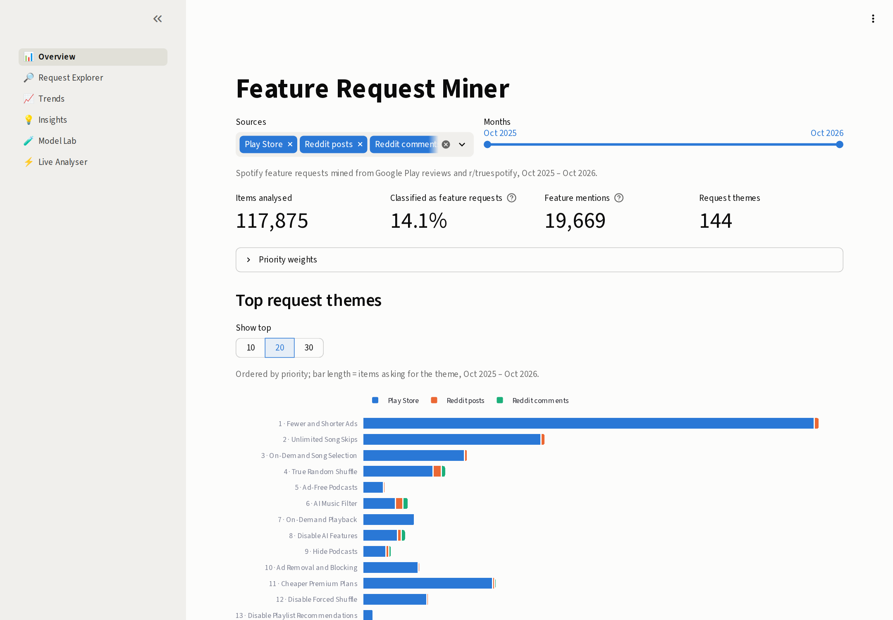
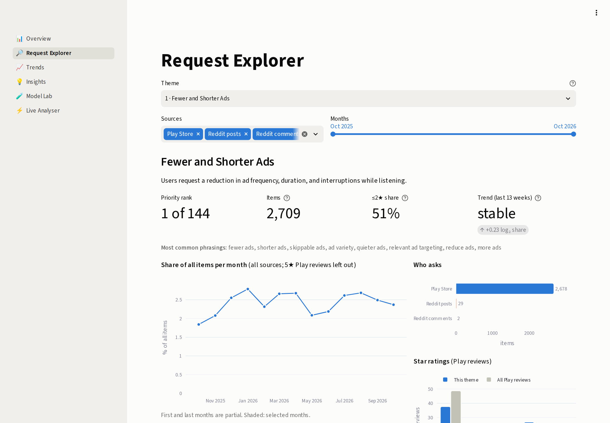
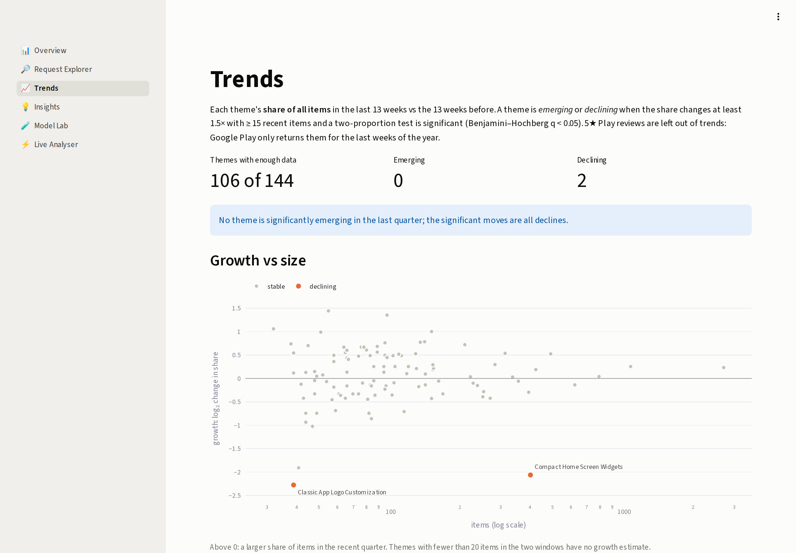
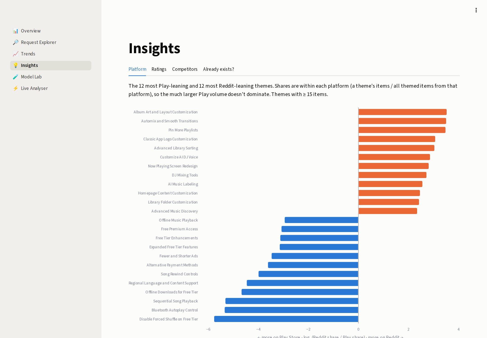
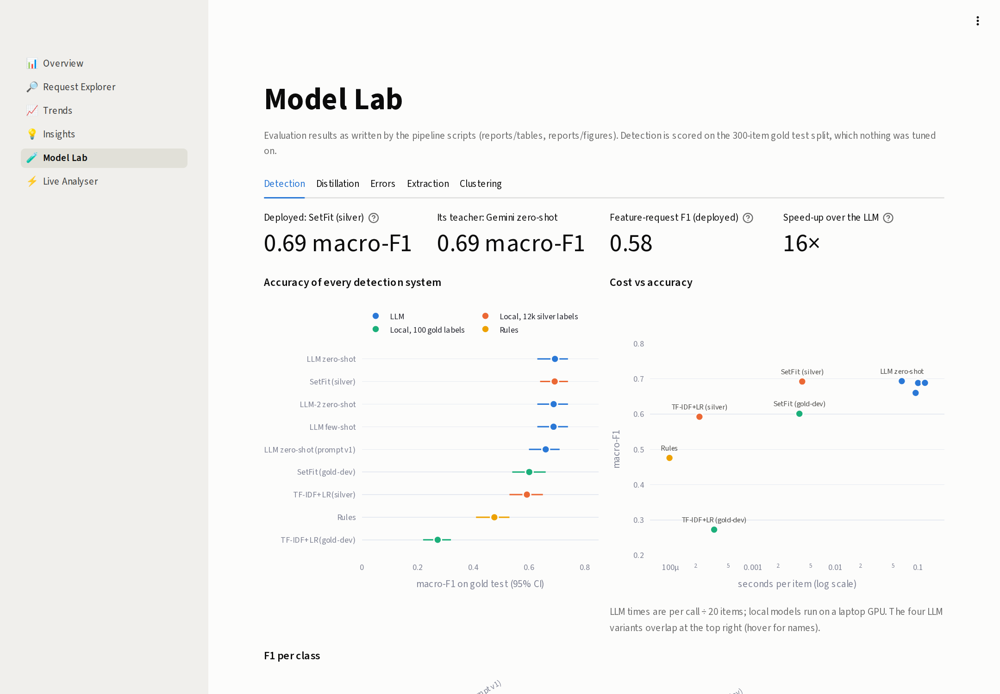
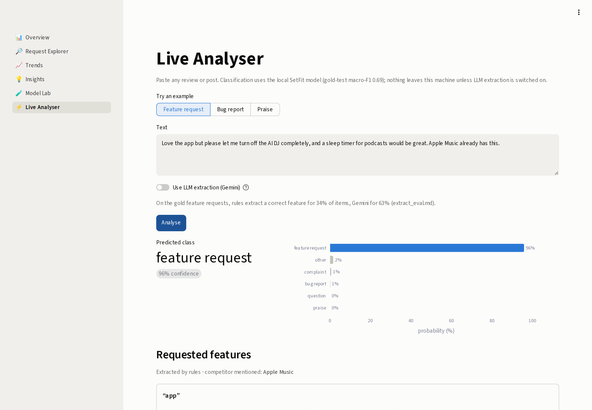

<!-- Generated by scripts/build_report.py from reports/report_template.md; edit the template, not this file. -->

<!--
How this file works: `make report` renders this template into reports/report.md.
Every number is a double-brace field read from reports/tables (written by the pipeline scripts),
so the report always matches the code. Write prose here and never type a result by hand.
-->

# Feature Request Miner: Extracting Customer Feature Requests from Unstructured Product Feedback

Advanced Social Text project · *authors* · October 2026

## Abstract

Product teams receive far more user feedback than they can read, and the feature requests in it are a
small, informally phrased minority. We present *Feature Request Miner*, a pipeline and dashboard that
detects feature requests in noisy social text, extracts the requested feature as a short phrase, groups
paraphrased requests into themes and ranks them. As a case study we collected one year of Spotify feedback,
117,875 English Google Play reviews and r/truespotify posts and comments, and labelled a
gold set of 400 items by hand. On the held-out test split an LLM classifier reaches
macro-F1 0.69; a SetFit model trained on 11,995
LLM-generated (silver) labels matches it (0.69) while running locally, about
16× faster per item and without API cost; hand-written
rules reach 0.48. LLM extraction is graded correct for
63% of gold requests, against
34% for a dependency-rule baseline. Clustering
19,669 extracted mentions yields 144 themes with a human-judged purity of
0.69. Free-tier limits dominate what users ask for (the top themes are
Fewer and Shorter Ads, Unlimited Song Skips and On-Demand Song Selection), opt-outs from AI and recommendation features appear in the angriest reviews, and
17 themes ask for features Spotify already offers to the users asking. Every number is
written by a script, and the results can be explored in a six-page interactive dashboard.

## 1. Introduction

App stores and online communities give software companies a continuous stream of unsolicited feedback. Our
one-year sample for a single app, Spotify on Android, contains 117,875 usable English items,
far more than a product team can read. Most of it is not actionable: in our hand-labelled sample only
8.8% of items are feature requests, while complaints make
up 35.8%. The requests that do exist are phrased informally and often
implicitly (*"would kill for a sleep timer"*, *"why can't I hide songs??"*, *"Apple Music has lyrics, just
saying"*), so keyword search misses many of them and returns many false positives, and the same request is
written in hundreds of different ways.

We chose Spotify because it is a large consumer app with a freemium model, so its feedback mixes functional
wishes (a sleep timer, better shuffle) with business requests (fewer ads, more skips, cheaper plans), and
because its users discuss it actively in public. We combine two channels that reach different users. Google
Play reviews are short, carry a star rating, and come from a broad population that includes many free-tier
users. The r/truespotify subreddit is an enthusiast community that writes longer posts, replies to each other
and votes on posts. Comparing the two shows how much the picture of "what users want" depends on where one
listens.

**Research questions**

- **RQ1** How accurately can feature requests be detected in app reviews and Reddit posts, and how do rules, LLMs and small local models compare in accuracy and cost?
- **RQ2** Can a small local model trained on LLM-generated (silver) labels match the LLM?
- **RQ3** Can the requested features be extracted (RQ3a) and grouped into coherent themes (RQ3b)?
- **RQ4** What do Spotify users ask for, how does it differ by platform and rating, and which requests concern features that already exist?

**Contributions**

- A reproducible end-to-end pipeline, from scraping to a ranked list of request themes, applied to one year of
  Spotify feedback from two platforms. Every stage is a script, and every number in this report is read from a
  table those scripts write.
- A comparison of rules, two LLM families, TF-IDF + logistic regression and SetFit for six-way feedback
  classification on a held-out gold test set, including latency, and a distillation experiment showing that a
  local model trained on LLM labels matches its LLM teacher.
- An evaluation of feature extraction and clustering in which the LLM judge is calibrated against a human check,
  showing that LLM-judged cluster purity overstates human-judged purity.
- Insights for Spotify, including which requests concern features that already exist (a discoverability
  problem) or exist only in Premium (a paywall signal), delivered through an interactive dashboard with a live
  analyser for new text.

## 2. Related Work

**App review mining.** Mining app store reviews for software engineering is an established field.
AR-Miner (Chen et al., 2014) filtered out non-informative reviews, grouped the rest with topic models and ranked
the groups for developers, which is the closest predecessor of our pipeline. Guzman and Maalej (2014) extracted
fine-grained app features from reviews with collocation finding and attached sentiment to them. Maalej and Nabil
(2015) classified reviews into bug reports, feature requests, user experiences and ratings, and showed that
metadata such as the star rating helps text classifiers. Panichella et al. (2015) combined linguistic patterns,
text features and sentiment to sort reviews into maintenance categories such as feature request and problem
discovery. Our label set follows these taxonomies, with *question* and *other* added because Reddit
conversations contain many of both. These works used app store data only and trained supervised models on
thousands of manual labels; we add Reddit and replace most manual labelling with LLM labels.

**LLMs as annotators.** Gilardi et al. (2023) found that zero-shot ChatGPT outperformed crowd workers on several
text annotation tasks at a fraction of the cost. Wang et al. (2021) used GPT-3 to label training data for smaller
models and reduced labelling cost substantially at similar accuracy. Training a small student on a larger
teacher's outputs is knowledge distillation (Hinton et al., 2015); we use the simplest form, training on the
teacher's hard labels.

**Few-shot classification.** SetFit (Tunstall et al., 2022) fine-tunes a Sentence-BERT encoder (Reimers and
Gurevych, 2019) contrastively on pairs of labelled examples and then trains a light classification head. It is
competitive with much larger models when only a few labels exist, which makes it a natural student for
distillation and a natural baseline for our 100 gold-dev labels.

**Topic modelling for short text.** Classical topic models such as LDA struggle with short, sparse documents.
BERTopic (Grootendorst, 2022) instead clusters document embeddings, reducing them with UMAP (McInnes et al., 2018)
and clustering them with HDBSCAN (Campello et al., 2013), then describes each cluster with class-based TF-IDF. We
use the same components but cluster the extracted feature phrases instead of whole documents, and use BERTopic on
the full texts as the comparison.

**Language models for social media.** BERTweet (Nguyen et al., 2020) showed that pre-training on tweets helps on
noisy social text. We did not pre-train a domain model; we use general-purpose sentence encoders and LLMs, and
leave domain-adapted encoders to future work.

## 3. Data

We collected Spotify Android reviews from Google Play and posts and comments from r/truespotify
(via the Arctic Shift archive). After de-duplication, a minimum-length filter and language identification,
182,528 raw items became **117,875** English items:

| step | items |
|:--|--:|
| collected | 182,528 |
| after id de-duplication | 154,031 |
| after minimum length | 125,222 |
| after text de-duplication | 122,714 |
| English | 117,875 |

| source             |   items | from       | to         |   median words | engagement > 0   | explicit request cue   |
|:-------------------|--------:|:-----------|:-----------|---------------:|:-----------------|:-----------------------|
| Play Store reviews |  93,950 | 2025-10-16 | 2026-10-15 |             19 | 25.0%            | 5.0%                   |
| Reddit comments    |   6,502 | 2025-10-16 | 2026-10-15 |             19 | 100.0%           | 4.4%                   |
| Reddit posts       |  17,423 | 2025-10-16 | 2026-10-15 |             53 | 69.0%            | 6.8%                   |

Play 5★ reviews were only retrievable from 2026-08-31 (Google Play pagination limit); 1–4★ reviews cover the full window.

**Ethics.** We collected only publicly visible content: Play Store reviews from the public store listing and
Reddit content from the Arctic Shift archive, which mirrors public Reddit data. Posts removed by moderators and
removed or deleted comments were dropped; for posts whose author deleted the body, only the title was kept. Usernames, avatars and author names were never written to disk;
items carry anonymised ids, and mentions of Reddit users inside the text are masked. The corpus keeps only text,
date, rating, engagement, app version and (for Reddit) flair. Quotes in this report and the dashboard are short,
are not linked to accounts, and we made no attempt to identify anyone. The text was sent to third-party LLM
APIs (Google Gemini and Groq) for labelling and extraction; it is public text, but this is a further copy outside
the platforms. Google Play's terms do not invite automated collection; we scraped at a low rate, for
non-commercial academic research only, and neither the raw data nor the LLM response cache is committed to
the repository or redistributed.

## 4. Annotation

We defined six labels (feature_request, bug_report, complaint, praise, question, other) and wrote
guidelines (`annotations/guidelines.md`). A stratified gold sample of **400** items
(enriched for request cues plus random) was labelled by one annotator and split into
100 dev and 300 test items.
The test split was used only for final scoring.

| label           |   dev |   test |   total | share   |
|:----------------|------:|-------:|--------:|:--------|
| feature_request |    11 |     24 |      35 | 8.8%    |
| bug_report      |    16 |     38 |      54 | 13.5%   |
| complaint       |    32 |    111 |     143 | 35.8%   |
| praise          |     8 |     49 |      57 | 14.2%   |
| question        |    23 |     51 |      74 | 18.5%   |
| other           |    10 |     27 |      37 | 9.2%    |
| total           |   100 |    300 |     400 | 100.0%  |

Intra-annotator agreement (a re-labelling pass over 27 pilot items):
raw agreement 81.5%, Cohen's κ = **0.76**.

**Hard boundaries.** Three boundaries caused most of the difficulty. *Feature request vs complaint*: much
negative feedback implies a wish ("way too many ads now"). The guidelines require an actionable ask: "way too
many ads" is a complaint, "please reduce the ads or let us skip them" is a request. Requests about ads, pricing
and plans count as feature requests, because they are changes users ask for. *Bug report vs complaint*: a
malfunction ("lyrics disappeared after the update") is a bug, whereas a deliberate change the user dislikes is a
complaint, or a request if they ask for it to be reversed. Most of the label changes between the two pilot
passes were on this boundary, and it was clarified in the guidelines between them. *Question vs other*, mostly
in Reddit comments: replies often end in a question to the poster, and only questions that seek information
count. Mixed items take the first applicable label in the priority order feature_request > bug_report >
question > complaint > praise > other.

**Conventions inferred from dev.** Comparing the first LLM prompt (v1, written from the guidelines) with the
dev labels showed two conventions the annotator applied consistently but the guidelines did not state
explicitly: (1) describing a disliked behaviour ("they removed X", "I don't like how it plays random songs") is a
complaint unless there is an explicit ask; (2) a problem description that asks other users for help or
confirmation ("anyone else?", "any fix?") is a question, not a bug report. Prompt v2 adds both. They were found
on dev only; the test labels were never changed after scoring.

## 5. Methods

The pipeline has five stages, each a script that reads the previous stage's output from disk. All LLM calls use
temperature 0 and are cached in a local SQLite database, so every stage can be re-run without new API calls.
All design choices (rules, prompts, hyperparameters and the model to deploy) were made on gold-dev.

- **Detection (RQ1).** Regex rules; Gemini (gemini-3.5-flash-lite) zero- and few-shot with two prompt versions;
  a second LLM family (Groq openai/gpt-oss-20b); TF-IDF + logistic regression and SetFit
  (all-mpnet-base-v2) trained on either the 100 gold-dev items or
  11,995 Gemini silver labels. The LLMs classify 20 items per
  call and return JSON. The silver sample is drawn from the whole corpus with gold items excluded.
- **Distillation (RQ2).** The SetFit model trained on silver labels is deployed on the full corpus.
  It was chosen on dev, where it scored 0.719 against
  0.718 for its teacher, and it needs no API calls.
- **Extraction (RQ3a).** Gemini extracts short canonical feature phrases plus a cited competitor;
  a dependency-parse rule extractor is the baseline. A judge from a different family (Groq) grades both.
  The LLM may return several features per item, or none when the item is not actually a request. The rules match
  spaCy dependency patterns such as *please add X*, *bring back X* and *I wish X* plus a list of competitor names.
  Phrases are normalised (fillers and articles stripped, nouns lemmatised). The judge sees only the text (and, for
  gold items, the annotator's phrases), not which method produced an extraction.
- **Clustering (RQ3b).** 8,370 distinct phrases (19,669 mentions) embedded with
  MiniLM, reduced with UMAP and clustered with HDBSCAN over a grid of 10 settings,
  chosen by rule (min_cluster_size=20, min_samples=5,
  152 clusters). Gemini proposed 25 merges, Groq confirmed
  8, leaving **144 themes**. BERTopic on item texts is the comparison.
  The selection rule takes the highest silhouette among settings that leave few mentions unassigned and give
  a manageable number of clusters, so no setting is picked by eye. Noise phrases close to a cluster centroid are
  attached to it afterwards. Gemini then names each theme and writes a one-line description.
- **Ranking.** priority = 0.4·z(log items) + 0.2·z(engagement) + 0.2·z(share ≤2★) + 0.2·z(growth);
  trends compare the last 13 weeks with the 13 before (two-proportion test, BH correction).
  Engagement is each item's percentile of thumbs-up or upvotes within its own source, so Play and Reddit are
  comparable. Growth is the log ratio of the theme's share of all corpus items in the two windows, which removes
  changes in how much feedback was collected. 5★ Play reviews are left out of growth, trends and monthly
  shares, because Google Play only returns them for the last weeks of the year; counting them would make
  every theme appear to shrink in the recent window. The weights are a judgement call; the dashboard lets users change
  them and see how the ranking moves.
- **Insights.** Platform lean compares a theme's share of Play items with its share of Reddit items. For the
  "already exists" analysis we wrote a catalogue of current Spotify features with their availability (everyone or
  Premium only); Gemini matches each theme against it and assigns one of four statuses: *exists*, *premium_only*,
  *partly* (a limited version exists) or *new*.

## 6. Experiments and Results

### 6.1 Detection (RQ1)

All systems on the gold test split (n = 300), 95% bootstrap CIs:

| system                    | train           |   macro_f1 | macro_f1_ci   |   accuracy |   kappa |   fr_f1 | fr_f1_ci     |   s_per_item |
|:--------------------------|:----------------|-----------:|:--------------|-----------:|--------:|--------:|:-------------|-------------:|
| Rules                     | none            |      0.476 | [0.41, 0.53]  |      0.513 |   0.394 |   0.323 | [0.17, 0.47] |     9.68e-05 |
| LLM zero-shot (prompt v1) | none            |      0.66  | [0.60, 0.71]  |      0.663 |   0.588 |   0.473 | [0.34, 0.59] |     0.094    |
| LLM zero-shot             | none            |      0.693 | [0.63, 0.74]  |      0.713 |   0.638 |   0.507 | [0.35, 0.64] |     0.064    |
| LLM few-shot              | 12 dev examples |      0.688 | [0.63, 0.74]  |      0.713 |   0.638 |   0.588 | [0.43, 0.72] |     0.1      |
| LLM-2 zero-shot           | none            |      0.689 | [0.63, 0.74]  |      0.732 |   0.651 |   0.571 | [0.38, 0.72] |     0.122    |
| TF-IDF+LR (gold-dev)      | 100 gold-dev    |      0.272 | [0.22, 0.32]  |      0.433 |   0.215 |   0.125 | [0.00, 0.29] |     0.000337 |
| SetFit (gold-dev)         | 100 gold-dev    |      0.601 | [0.54, 0.66]  |      0.667 |   0.569 |   0.364 | [0.17, 0.54] |     0.004    |
| TF-IDF+LR (silver)        | 11995 silver    |      0.593 | [0.53, 0.65]  |      0.623 |   0.53  |   0.432 | [0.28, 0.57] |     0.000224 |
| SetFit (silver)           | 11995 silver    |      0.692 | [0.64, 0.74]  |      0.71  |   0.636 |   0.58  | [0.43, 0.71] |     0.004    |

The best LLM setting reaches macro-F1 0.693; the deployed SetFit (silver) model
scores 0.692 [0.64, 0.74], against 0.693 for its teacher,
at 0.004 s per item instead of 0.064.
Rules reach 0.476. Feature-request F1 of the deployed model is
0.58 [0.43, 0.71]; with only 24
feature requests in the test split, class-level CIs are wide.

Three further points stand out. First, the rules overfit: they scored 0.628 on the dev
items they were written against but 0.476 on test. Second, the LLM settings are
statistically indistinguishable from each other: the second LLM family, few-shot examples and prompt v2 all land
within each other's confidence intervals, although prompt v2 is consistently ahead of v1
(0.660 → 0.693, κ
0.59 → 0.64). Third, the LLMs' κ with the
annotator (0.64) is below the annotator's own intra-annotator κ (0.76), so
there is still room between the models and the human ceiling.

Per-class F1:

| class           |   Rules |   LLM zero-shot (prompt v1) |   LLM zero-shot |   LLM few-shot |   LLM-2 zero-shot |   TF-IDF+LR (gold-dev) |   SetFit (gold-dev) |   TF-IDF+LR (silver) |   SetFit (silver) |
|:----------------|--------:|----------------------------:|----------------:|---------------:|------------------:|-----------------------:|--------------------:|---------------------:|------------------:|
| feature_request |    0.32 |                        0.47 |            0.51 |           0.59 |              0.57 |                   0.12 |                0.36 |                 0.43 |              0.58 |
| bug_report      |    0.41 |                        0.64 |            0.65 |           0.59 |              0.57 |                   0.29 |                0.61 |                 0.54 |              0.6  |
| complaint       |    0.61 |                        0.68 |            0.75 |           0.77 |              0.78 |                   0.55 |                0.73 |                 0.66 |              0.74 |
| praise          |    0.61 |                        0.83 |            0.81 |           0.82 |              0.84 |                   0.15 |                0.76 |                 0.83 |              0.82 |
| question        |    0.63 |                        0.71 |            0.77 |           0.75 |              0.82 |                   0.52 |                0.72 |                 0.67 |              0.78 |
| other           |    0.28 |                        0.63 |            0.67 |           0.61 |              0.55 |                   0    |                0.42 |                 0.42 |              0.65 |

Praise is the easiest class for the LLMs and the silver-trained models. *feature_request* is the hardest or
second-hardest class for each of them, with *other* and *bug_report* close behind: these classes are rare and
border on several others.

### 6.2 Distillation (RQ2)

Trained on 100 gold labels, SetFit reaches 0.601
and TF-IDF+LR 0.272; trained on silver labels they reach
0.692 and 0.593.

Silver labels close the gap to the teacher. With 100 examples, a bag-of-words
model has too few examples per class to learn anything useful; SetFit's pre-trained encoder already does well,
but it still gains 0.09 macro-F1 from
the silver data. The silver labels are noisy (the teacher agrees with the annotator on only
71% of test items), yet the student is not worse than the teacher. The student does not
exceed it either: it inherits the teacher's systematic mistakes (§6.3), which caps it at the teacher's level.

In practice this means a one-off LLM labelling run buys a model that classifies the whole corpus, and any new
feedback, offline, at 0.004 s per item and with no per-item cost or quota.
The LLM is then needed only for extraction, on the much smaller set of predicted requests. Since the student
tracks its teacher, the way to improve it is to improve the teacher, as prompt v2 did, and to relabel.

### 6.3 Error analysis

The deployed model makes 87 errors on the test split and its teacher 86.
Both are wrong on 60 items, and on 51 of them they predict the same wrong label,
which points to ambiguous items or annotator conventions. Most frequent confusions of the deployed model:

| gold       | predicted       |   n | share_of_errors   |
|:-----------|:----------------|----:|:------------------|
| complaint  | feature_request |  15 | 17.0%             |
| complaint  | bug_report      |  13 | 15.0%             |
| question   | other           |   8 | 9.0%              |
| bug_report | question        |   6 | 7.0%              |
| bug_report | complaint       |   6 | 7.0%              |

The examples in `reports/tables/detect_errors.md` show that most errors sit on the boundaries discussed in §4.

- **Complaint → feature request.** *"stop stopping my music to ask me to rate you!"* is an annoyance written as an
  imperative; by the letter of convention (1) it is arguably a request, and the teacher says so too. A long review
  explaining that Premium is forced on users and that YouTube lets them play whichever song they want contains an
  embedded wish (choose songs, go back and forward) inside a complaint. Some of these gold labels are debatable.
- **Complaint → bug report.** Downloaded playlists that stopped working on a camping trip describe a malfunction,
  but the reviewer's point is that Premium is unreliable offline. In *"AI music is destroying this app … AI is
  crashing and ruining it all"*, "crashing" is figurative, and the model reads it literally.
- **Question → other.** Reddit replies such as *"It has the same layouts as the Mix feature … Did you click that by
  any chance?"* are mostly information with a question attached; whether the question makes it a question is a
  fine call.
- **Bug report → question.** *"Spotify app auto closes when I launch it … Are you fixing this anytime soon???"* is a
  bug report with a rhetorical question, which the model takes literally.

These are the boundaries the guidelines and the prompt conventions try to pin down (bug vs complaint is also the
one on which the annotator changed labels between pilot passes), and most of these errors are shared with the
teacher. More silver data would not fix them; a second annotator and sharper guidelines would.

### 6.4 Extraction (RQ3a)

On the gold feature requests, the judge grades the LLM extraction correct for
**63%** of items and the rules for
34%; on 100 corpus
items the classifier labels as requests: 83% vs
24%. Phrase-matching F1 against the annotator
(cosine ≥ 0.6): LLM 0.444 [0.30, 0.59],
rules 0.373 [0.20, 0.55].

| setting       | method   |   items |   precision |   recall |    f1 | f1_ci        |   judge_correct |   judge_partial |   judge_wrong |
|:--------------|:---------|--------:|------------:|---------:|------:|:-------------|----------------:|----------------:|--------------:|
| gold all      | rules    |      34 |       0.458 |    0.314 | 0.373 | [0.20, 0.55] |           0.343 |           0.114 |         0.543 |
| gold all      | llm      |      34 |       0.391 |    0.514 | 0.444 | [0.30, 0.59] |           0.629 |           0.171 |         0.2   |
| gold dev      | rules    |      11 |       0.333 |    0.182 | 0.235 | [0.00, 0.53] |           0.273 |           0.091 |         0.636 |
| gold dev      | llm      |      11 |       0.231 |    0.273 | 0.25  | [0.00, 0.50] |           0.727 |           0.182 |         0.091 |
| gold test     | rules    |      23 |       0.5   |    0.375 | 0.429 | [0.23, 0.63] |           0.375 |           0.125 |         0.5   |
| gold test     | llm      |      23 |       0.455 |    0.625 | 0.526 | [0.36, 0.69] |           0.583 |           0.167 |         0.25  |
| corpus sample | rules    |     100 |             |          |       |              |           0.24  |           0.15  |         0.61  |
| corpus sample | llm      |     100 |             |          |       |              |           0.83  |           0.07  |         0.1   |

Phrase-matching F1 is low for both methods because the annotator's phrases are terse and personal, while the LLM
writes product-style phrases ("fewer ads"); the judge grades are the better measure. The rules fail mainly on
implicit requests ("why can't I…", "Apple Music has…"), where no request pattern matches. The LLM also acts as a
precision filter: for classifier false positives it returns no feature, which the judge grades as correct, and
this contributes to its higher grade on the corpus sample than on gold.

### 6.5 Clustering (RQ3b)

| method                      |   n_clusters |   outlier_rate |   outlier_mentions |   silhouette |   largest_share |
|:----------------------------|-------------:|---------------:|-------------------:|-------------:|----------------:|
| A: phrases + UMAP + HDBSCAN |          144 |          0.065 |              0.036 |        0.13  |           0.147 |
| B: BERTopic on texts        |           52 |          0.342 |              0.342 |        0.066 |           0.086 |

Purity on sampled clusters (share of members that belong):

| method             | rater                   |   clusters |   members |   purity | ci           |   fully_pure |
|:-------------------|:------------------------|-----------:|----------:|---------:|:-------------|-------------:|
| A: phrase clusters | LLM judge               |         30 |       300 |    0.797 | [0.72, 0.86] |         0.3  |
| B: BERTopic        | LLM judge               |         30 |       300 |    0.867 | [0.81, 0.92] |         0.4  |
| A: phrase clusters | human                   |         20 |       200 |    0.685 | [0.61, 0.76] |         0.05 |
| A: phrase clusters | LLM judge, human subset |         20 |       200 |    0.77  | [0.68, 0.85] |         0.15 |

On the 200 phrases checked by hand, the LLM judge agrees with the human on
83% (Cohen's κ **0.59**) but is more lenient
(23% vs 32% intruders), so LLM-judged purity
(0.770) overstates human purity
(0.685) on the same themes. Theme names fit their phrases for
60% of themes and partly for 40%.

BERTopic scores a higher purity (0.867 vs
0.797), but the comparison flatters it. It clusters whole posts, so its
52 topics are broad subjects (ads, shuffle, podcasts), and a review is easily judged to
"belong" to a broad subject even when its actual request differs. It also leaves
34% of items out as outliers, against 4%
of mentions for the phrase clusters, and it can put a review that makes two requests into only one topic. The
phrase clusters are narrow and specific, which makes intruders easier to spot and creates some near-duplicate
themes (wording splits that the conservative merge step did not join), but it is the specificity a ranking of
requests needs. For an overview of what people talk about, BERTopic is adequate; for a list of what people ask
for, phrase clustering is the better choice.

## 7. Insights (RQ4)

### 7.1 What users ask for

|   rank | name                     |   items | low_rating_share   |   growth |   priority | trend   |
|-------:|:-------------------------|--------:|:-------------------|---------:|-----------:|:--------|
|      1 | Fewer and Shorter Ads    |   2,709 | 51.2%              |    0.231 |      1.714 | stable  |
|      2 | Unlimited Song Skips     |   1,082 | 64.2%              |    0.254 |      1.598 | stable  |
|      3 | On-Demand Song Selection |     624 | 74.2%              |   -0.139 |      1.315 | stable  |
|      4 | True Random Shuffle      |     492 | 55.5%              |    0.523 |      1.269 | stable  |
|      5 | Ad-Free Podcasts         |     136 | 72.4%              |    0.772 |      1.114 | stable  |
|      6 | AI Music Filter          |     271 | 80.8%              |   -0.424 |      1.088 | stable  |
|      7 | On-Demand Playback       |     314 | 71.2%              |    0.535 |      1.081 | stable  |
|      8 | Disable AI Features      |     254 | 78.6%              |   -0.282 |      1.077 | stable  |
|      9 | Hide Podcasts            |     170 | 80.3%              |   -0.331 |      1.009 | stable  |
|     10 | Ad Removal and Blocking  |     338 | 65.7%              |    0.028 |      0.981 | stable  |

### 7.2 Trends

Comparing the last 13 weeks (24,691 items) with the
13 before (29,438): **0** themes emerge significantly
and **2** decline:

| name                           |   prev_items |   recent_items |   ratio |     q |
|:-------------------------------|-------------:|---------------:|--------:|------:|
| Classic App Logo Customization |           29 |              5 |   0.206 | 0.021 |
| Compact Home Screen Widgets    |          319 |             64 |   0.239 | 0     |

Both declines are the aftermath of a spike rather than solved problems. The larger one,
"Compact Home Screen Widgets"
(319 → 64 items),
followed an app update in June 2026 that replaced the small Android home-screen widget with a larger one: the
requests to bring the old widget back are concentrated in the days after that release and in that app version,
then fade, but they do not stop. Requests for the classic app logo likewise peak in May 2026 and then fade.
No theme grows significantly: the request mix of the last quarter is much like that of the quarter before.

### 7.3 Platform and rating differences

Most Reddit-leaning themes: Album Art and Layout Customization, Automix and Smooth Transitions, Pin More Playlists, Classic App Logo Customization and Advanced Library Sorting. Most Play-leaning: Disable Forced Shuffle on Free Tier, Bluetooth Autoplay Control, Sequential Song Playback, Offline Downloads for Free Tier and Regional Language and Content Support.
Themes in the lowest-rated Play reviews: AI Music Filter, Disable Playlist Recommendations, Disable AI Features, Disable Podcast Transcripts and Disable Podcasts and Video Playback.

The two platforms ask for different things. Reddit users, an enthusiast community, ask for customisation and
control of their library. Play reviewers ask about the limits of the free tier: playback order,
downloads, rewinding and payment options. The lowest-rated reviews are dominated by requests to switch something
*off* (AI-generated music, AI features, recommendations, podcasts) rather than to add something.

### 7.4 Competitors

Most cited: YouTube Music (645), Apple Music (229), SoundCloud (59), Pandora (56), Amazon Music (36).

YouTube Music is cited far more often than any other service, mostly alongside requests about ads, price and
skips, i.e. as the free alternative. Apple Music is cited mostly alongside requests for lossless, high-quality
audio.

### 7.5 Requests for features that already exist

Of 144 themes, 17 ask for something that already exists for the users
asking, usually for everyone (discoverability), 23 for Premium-only features on the free tier (paywall),
17 for more than a limited version offers, and 87 are new.

Largest "already exists" themes:

| name                          | feature                | availability   |   items |
|:------------------------------|:-----------------------|:---------------|--------:|
| Synced Lyrics Display         | Lyrics                 | all            |     425 |
| Disable Forced Shuffle        | Turn off Smart Shuffle | premium        |     396 |
| Ad-Free Premium Experience    | Ad-free listening      | premium        |     143 |
| Ad-Free Podcasts              | Ad-free listening      | premium        |     136 |
| Monthly Listening Statistics  | Listening history      | all            |      89 |
| Search and History Management | Listening history      | all            |      83 |

### 7.6 What Spotify could do with this

- **Free-tier limits are the main request.** The top of the ranking (Fewer and Shorter Ads, Unlimited Song Skips and On-Demand Song Selection) is about the
  business model, not missing functionality. These are pricing and packaging decisions; the volume and the low
  ratings attached to them suggest room for options between the free tier and full Premium.
- **Give users an off switch.** Opt-outs from AI music, AI features, recommendations and podcasts sit in the
  angriest reviews. Settings toggles and labelling of AI-generated tracks are cheap compared with the
  dissatisfaction they would address.
- **Fix discoverability before building.** 17 themes ask for features that already
  exist, the largest being "Synced Lyrics Display" (*Lyrics*).
  Better in-app discovery, or a reply to the review pointing to the feature, would answer these users.
- **Watch reactions to releases.** "Bring back …" themes, such as the widget, spike after an update. Tracking them
  per app version gives early warning that a change is unpopular.
- **Listen on more than one channel.** Play and Reddit produce different priority lists; deciding from one of them
  alone would miss either the free-tier majority or the power users.

### 7.7 The dashboard

The dashboard (`make dashboard`) presents the results in six pages. It only reads files written by the pipeline,
so it runs offline. A filter row for sources and months is shared by all pages.

- **Overview**: headline numbers, the top themes and the full ranking table. Sliders change the four priority
  weights and show how each theme's rank moves.
- **Request Explorer**: one theme in depth: common phrasings, monthly share, sources, star ratings compared with
  all Play reviews, competitors and example quotes, sortable by confidence or engagement.
- **Trends**: growth against size for every theme, the biggest movers and small multiples of chosen themes.
- **Insights**: platform lean, rating profile, competitors and the "already exists?" status of each theme.
- **Model Lab**: the evaluation of every stage (detection with CIs and confusion matrices, distillation, errors,
  extraction and clustering, including the human purity check).
- **Live Analyser**: classifies new text with the local model, extracts its features (rules, or the LLM as an
  opt-in) and finds the nearest existing themes, flagging possibly new requests.

## 8. Limitations and Ethics

- Single annotator (intra-annotator κ 0.76); some gold labels are debatable.
  Without a second annotator we cannot separate model error from label noise on the hard boundaries, and the
  intra-annotator κ comes from a small pilot of 27 items.
- Only 24 feature requests in gold test: wide CIs for class-level metrics.
  The deployed model's feature-request F1 has the interval [0.43, 0.71], so most differences between systems
  on that class are not significant; this is why macro-F1 is the primary metric.
- Extraction quality and most purity numbers are LLM judgments; the human check (κ 0.59) shows the judge is lenient.
  The judge comes from a different model family than the extractor to avoid self-preference, but the human check
  shows it still flags fewer intruders than a person, so LLM-judged purity should be read as an upper bound.
- Clustering over-splits some requests by wording; the merge step is conservative (8 of 25 proposals kept).
  A few near-duplicate themes remain (for example, two on-demand playback themes), which splits their volume and
  lowers their rank.
- "Already exists" statuses depend on a hand-written catalogue and are sensitive to the prompt.
  The matching LLM is not stable between runs: running it twice with the same catalogue and prompt (once after
  the catalogue was corrected, once again on another machine) moved several themes between statuses, mostly
  small ones and mostly between *exists*, *partly* and *premium_only*. The per-theme statuses are therefore
  indicative; the overall split and the largest themes are more reliable than any single status.
- Play 5★ reviews were only retrievable from 2026-08-31 (Google Play pagination limit); 1–4★ reviews cover the full window.
  Trends leave 5★ Play reviews out for this reason. The rating statistics (≤2★ share, mean rating) use all Play
  reviews, so their absolute levels over-represent low ratings; comparisons between themes, and between a theme
  and all Play reviews, are less affected because the same bias applies across them.
- LLM non-determinism (temperature 0, cached responses), sampling bias of reviewers and Reddit users, platform terms of service.
  Even at temperature 0, re-running an LLM stage without the cache can give slightly different results; the cached
  responses make the reported numbers reproducible. Reviewers and Reddit users are self-selected and not
  representative of all Spotify users: angry users and enthusiasts are over-represented, and the data are English
  only and Android only. Data collection respected the ethical constraints in §3.

## 9. Conclusion and Future Work

**RQ1.** Feature requests can be detected in noisy social text with moderate accuracy. The best systems reach
macro-F1 of about 0.69 over six classes and feature-request F1 of about
0.58. Rules are cheap but overfit their development data; LLMs from two families perform alike,
and prompt conventions helped more than few-shot examples, although neither difference is significant. The main
errors sit on the boundaries that were hardest to define in the guidelines.

**RQ2.** Yes. A SetFit model trained on 11,995 LLM labels matches its
teacher (0.692 vs 0.693), beats the same model trained on
100 hand labels, and runs locally at no per-item cost. It inherits the teacher's
mistakes, so it is unlikely to exceed the teacher.

**RQ3.** LLM extraction works well (63% correct on gold,
83% on the corpus sample) and clearly beats dependency rules,
mostly because it handles implicit requests. Phrase clustering produces specific, usable themes with a human
purity of 0.69, but it splits some requests by wording, and LLM-judged purity
overstates quality.

**RQ4.** Spotify users mostly ask to loosen the free tier: Fewer and Shorter Ads, Unlimited Song Skips and On-Demand Song Selection lead the ranking. Requests differ
strongly by platform: Reddit asks for customisation, Play for free-tier limits. The angriest reviews ask to turn
features off. 17 themes ask for features that already exist and
23 for Premium-only ones, pointing to discoverability and pricing rather than
missing functionality.

**Future work.** A second annotator to measure inter-annotator agreement and settle the hard boundaries; a larger
gold set with more feature requests; App Store data and multilingual reviews; active learning that sends the
student's least confident items to the LLM or a human; a domain-adapted encoder for clustering, which might reduce
wording splits; and running the pipeline continuously so that requests can be tracked per app release.

## References

Campello, R. J. G. B., Moulavi, D., and Sander, J. (2013). Density-based clustering based on hierarchical density
estimates. In *Advances in Knowledge Discovery and Data Mining (PAKDD 2013)*, LNCS 7819, pp. 160–172. Springer.

Chen, N., Lin, J., Hoi, S. C. H., Xiao, X., and Zhang, B. (2014). AR-Miner: Mining informative reviews for
developers from mobile app marketplace. In *Proceedings of the 36th International Conference on Software
Engineering (ICSE 2014)*, pp. 767–778. ACM.

Gilardi, F., Alizadeh, M., and Kubli, M. (2023). ChatGPT outperforms crowd workers for text-annotation tasks.
*Proceedings of the National Academy of Sciences*, 120(30), e2305016120.

Grootendorst, M. (2022). BERTopic: Neural topic modeling with a class-based TF-IDF procedure. *arXiv preprint
arXiv:2203.05794*.

Guzman, E., and Maalej, W. (2014). How do users like this feature? A fine grained sentiment analysis of app
reviews. In *2014 IEEE 22nd International Requirements Engineering Conference (RE)*, pp. 153–162. IEEE.

Hinton, G., Vinyals, O., and Dean, J. (2015). Distilling the knowledge in a neural network. *arXiv preprint
arXiv:1503.02531*.

Maalej, W., and Nabil, H. (2015). Bug report, feature request, or simply praise? On automatically classifying app
reviews. In *2015 IEEE 23rd International Requirements Engineering Conference (RE)*, pp. 116–125. IEEE.

McInnes, L., Healy, J., and Melville, J. (2018). UMAP: Uniform manifold approximation and projection for dimension
reduction. *arXiv preprint arXiv:1802.03426*.

Nguyen, D. Q., Vu, T., and Nguyen, A. T. (2020). BERTweet: A pre-trained language model for English Tweets. In
*Proceedings of the 2020 Conference on Empirical Methods in Natural Language Processing: System Demonstrations*,
pp. 9–14. ACL.

Panichella, S., Di Sorbo, A., Guzman, E., Visaggio, C. A., Canfora, G., and Gall, H. C. (2015). How can I improve
my app? Classifying user reviews for software maintenance and evolution. In *2015 IEEE International Conference
on Software Maintenance and Evolution (ICSME)*, pp. 281–290. IEEE.

Reimers, N., and Gurevych, I. (2019). Sentence-BERT: Sentence embeddings using Siamese BERT-networks. In
*Proceedings of the 2019 Conference on Empirical Methods in Natural Language Processing (EMNLP-IJCNLP)*,
pp. 3982–3992. ACL.

Tunstall, L., Reimers, N., Jo, U. E. S., Bates, L., Korat, D., Wasserblat, M., and Pereg, O. (2022). Efficient
few-shot learning without prompts. *arXiv preprint arXiv:2209.11055*.

Wang, S., Liu, Y., Xu, Y., Zhu, C., and Zeng, M. (2021). Want to reduce labeling cost? GPT-3 can help. In
*Findings of the Association for Computational Linguistics: EMNLP 2021*, pp. 4195–4205. ACL.
