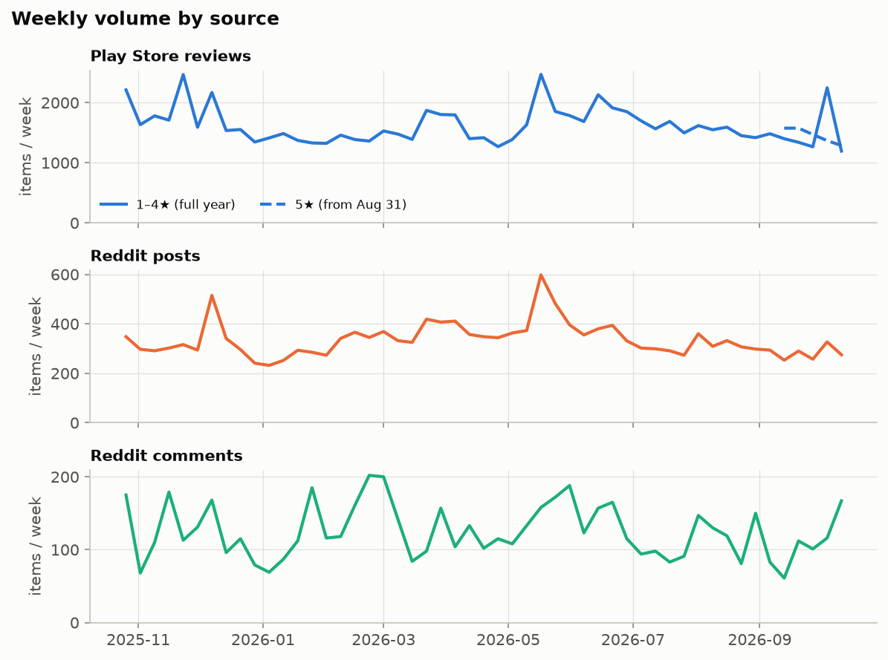
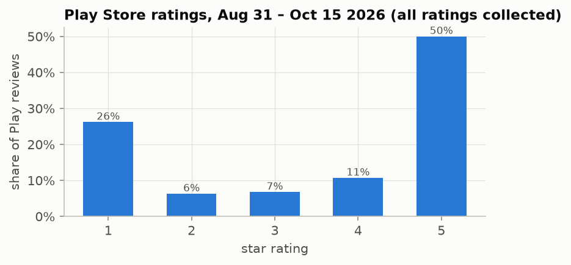
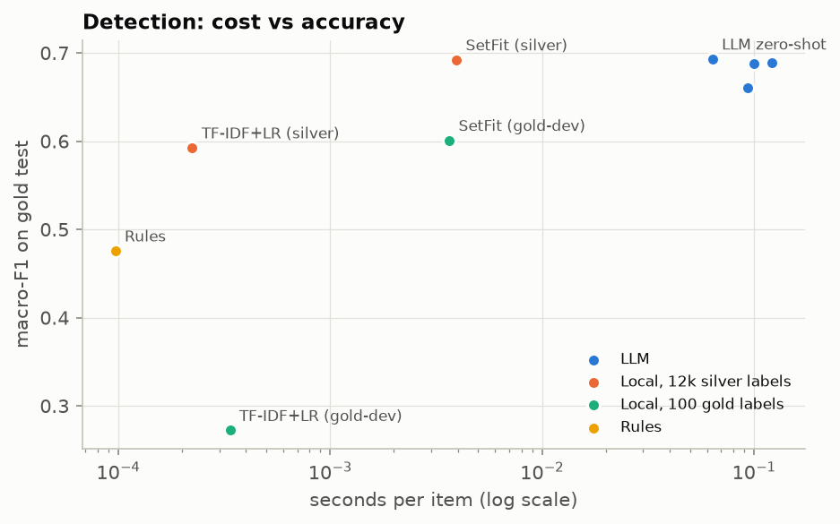
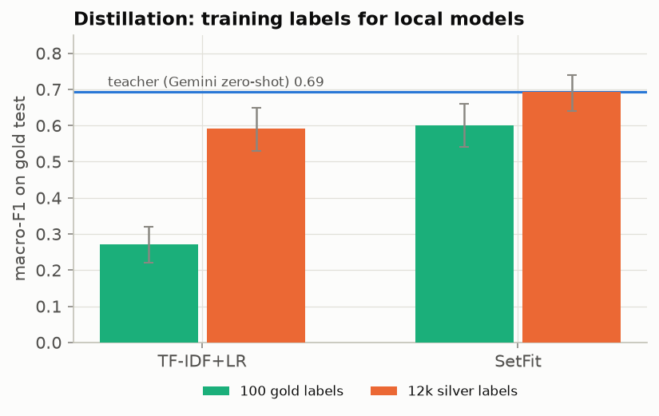
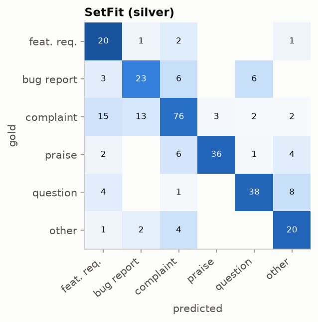
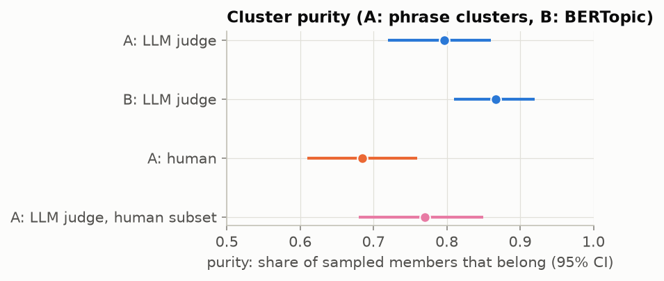
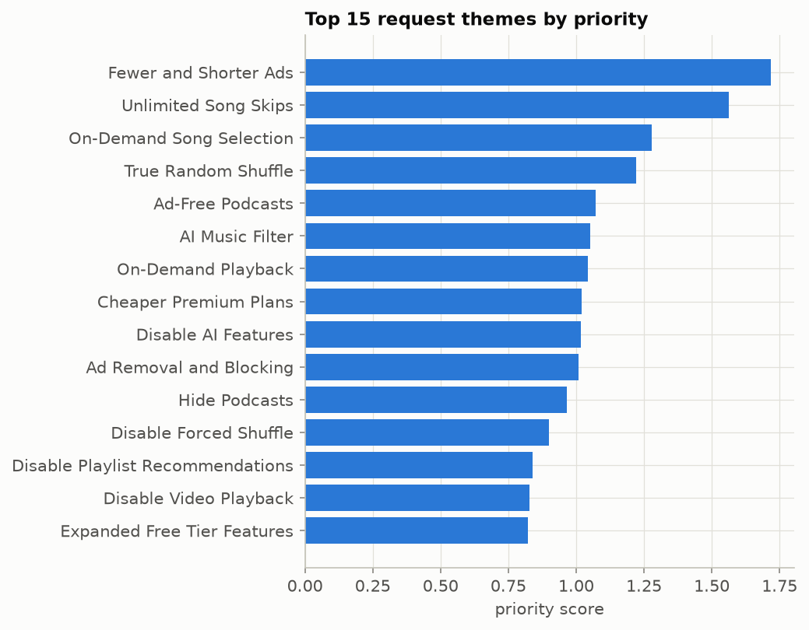

# Feature Request Miner: Extracting Customer Feature Requests from Unstructured Product Feedback

Advanced Social Text project · *authors* · *date*

> **How this file works.** `make report` renders this template into `reports/report.md`.
> Every number is a double-brace field read from `reports/tables` (written by the pipeline scripts),
> so the report always matches the code. Write prose here, replace the ✍️ **TODO** blocks, and
> never type a result by hand.

## Abstract

> ✍️ **TODO (team):** 150–200 words: problem, data ({{ n(corpus['english']) }} Spotify items),
> approach (LLM-labelled distillation, extraction, clustering), headline results (deployed
> detector macro-F1 {{ f2(dep['macro_f1']) }}, {{ grid['themes'] }} themes, top requests), and the dashboard.

## 1. Introduction

> ✍️ **TODO (team):** problem and motivation: product teams receive far more feedback than they
> can read; feature requests are a small, valuable fraction ({{ pct(gold['by_split'].loc['feature_request', 'share'], 1) }}
> of our gold sample). Why Spotify, why Play Store + Reddit.

**Research questions**

- **RQ1** How accurately can feature requests be detected in app reviews and Reddit posts, and how do rules, LLMs and small local models compare in accuracy and cost?
- **RQ2** Can a small local model trained on LLM-generated (silver) labels match the LLM?
- **RQ3** Can the requested features be extracted (RQ3a) and grouped into coherent themes (RQ3b)?
- **RQ4** What do Spotify users ask for, how does it differ by platform and rating, and which requests concern features that already exist?

> ✍️ **TODO (team):** contributions (3–4 bullets).

## 2. Related Work

> ✍️ **TODO (team):** app review mining (Maalej & Nabil 2015; Guzman & Maalej 2014; Panichella et al. 2015;
> Chen et al. 2014, AR-Miner); LLMs as annotators (Gilardi et al. 2023); few-shot classification
> (SetFit, Tunstall et al. 2022); topic modelling for short text (BERTopic, Grootendorst 2022);
> social-media language models (BERTweet, Nguyen et al. 2020).

## 3. Data

We collected Spotify Android reviews from Google Play and posts and comments from r/truespotify
(via the Arctic Shift archive). After de-duplication, a minimum-length filter and language identification,
{{ n(corpus['raw']) }} raw items became **{{ n(corpus['english']) }}** English items:

| step | items |
|:--|--:|
| collected | {{ n(corpus['raw']) }} |
| after id de-duplication | {{ n(corpus['after_id_dedup']) }} |
| after minimum length | {{ n(corpus['min_words']) }} |
| after text de-duplication | {{ n(corpus['after_text_dedup']) }} |
| English | {{ n(corpus['english']) }} |

{{ md(csum.reset_index(), pct_cols=('engagement > 0', 'explicit request cue')) }}

{{ corpus_note }}

> ✍️ **TODO (team):** ethics: public data only, usernames dropped, quotes paraphrased or short,
> platform terms of service, no attempt to identify users.

## 4. Annotation

We defined six labels (feature_request, bug_report, complaint, praise, question, other) and wrote
guidelines (`annotations/guidelines.md`). A stratified gold sample of **{{ gold['items'] }}** items
(enriched for request cues plus random) was labelled by one annotator and split into
{{ gold['by_split'].loc['total', 'dev'] }} dev and {{ gold['by_split'].loc['total', 'test'] }} test items.
The test split was used only for final scoring.

{{ md(gold['by_split'].reset_index(), pct_cols=('share',)) }}

Intra-annotator agreement (a re-labelling pass over {{ gold['pilot_items'] }} pilot items):
raw agreement {{ pct(gold['agreement'], 1) }}, Cohen's κ = **{{ f2(gold['kappa']) }}**.

> ✍️ **TODO (team):** discuss the hardest boundaries (complaint vs feature request, question vs other)
> and the two conventions inferred from dev (prompt v2).

## 5. Methods

> ✍️ **TODO (team):** describe each stage; the numbers below are filled in automatically.

- **Detection (RQ1).** Regex rules; Gemini ({{ teacher['model'] }}) zero- and few-shot with two prompt versions;
  a second LLM family (Groq {{ det.loc['LLM-2 zero-shot', 'model'] }}); TF-IDF + logistic regression and SetFit
  (all-mpnet-base-v2) trained on either the {{ gold['by_split'].loc['total', 'dev'] }} gold-dev items or
  {{ n(det.loc['SetFit (silver)', 'train'].split()[0]) }} Gemini silver labels.
- **Distillation (RQ2).** The SetFit model trained on silver labels is deployed on the full corpus.
- **Extraction (RQ3a).** Gemini extracts short canonical feature phrases plus a cited competitor;
  a dependency-parse rule extractor is the baseline. A judge from a different family (Groq) grades both.
- **Clustering (RQ3b).** {{ n(grid['phrases']) }} distinct phrases ({{ n(grid['mentions']) }} mentions) embedded with
  MiniLM, reduced with UMAP and clustered with HDBSCAN over a grid of {{ grid['settings'] }} settings,
  chosen by rule (min_cluster_size={{ grid['min_cluster_size'] }}, min_samples={{ grid['min_samples'] }},
  {{ grid['clusters_before'] }} clusters). Gemini proposed {{ grid['proposed_merges'] }} merges, Groq confirmed
  {{ grid['confirmed'] }}, leaving **{{ grid['themes'] }} themes**. BERTopic on item texts is the comparison.
- **Ranking.** priority = 0.4·z(log items) + 0.2·z(engagement) + 0.2·z(share ≤2★) + 0.2·z(growth);
  trends compare the last {{ trends['weeks'] }} weeks with the {{ trends['weeks'] }} before (two-proportion test, BH correction).

## 6. Experiments and Results

### 6.1 Detection (RQ1)

All systems on the gold test split (n = {{ int(dep['n']) }}), 95% bootstrap CIs:

{{ md(det.reset_index(), ['system', 'train', 'macro_f1', 'macro_f1_ci', 'accuracy', 'kappa', 'fr_f1', 'fr_f1_ci', 's_per_item']) }}

The best LLM setting reaches macro-F1 {{ f3(det[det.index.str.startswith('LLM')]['macro_f1'].max()) }}; the deployed SetFit (silver) model
scores {{ f3(dep['macro_f1']) }} {{ dep['macro_f1_ci'] }}, against {{ f3(teacher['macro_f1']) }} for its teacher,
at {{ f3(dep['s_per_item']) }} s per item instead of {{ f3(teacher['s_per_item']) }}.
Rules reach {{ f3(det.loc['Rules', 'macro_f1']) }}. Feature-request F1 of the deployed model is
{{ f2(dep['fr_f1']) }} {{ dep['fr_f1_ci'] }}; with only {{ gold['by_split'].loc['feature_request', 'test'] }}
feature requests in the test split, class-level CIs are wide.

Per-class F1:

{{ md(per_class.reset_index().rename(columns={'': 'class'})) }}

### 6.2 Distillation (RQ2)

Trained on {{ gold['by_split'].loc['total', 'dev'] }} gold labels, SetFit reaches {{ f3(det.loc['SetFit (gold-dev)', 'macro_f1']) }}
and TF-IDF+LR {{ f3(det.loc['TF-IDF+LR (gold-dev)', 'macro_f1']) }}; trained on silver labels they reach
{{ f3(det.loc['SetFit (silver)', 'macro_f1']) }} and {{ f3(det.loc['TF-IDF+LR (silver)', 'macro_f1']) }}.

> ✍️ **TODO (team):** interpret: silver labels close the gap to the teacher; what that means for cost.

### 6.3 Error analysis

The deployed model makes {{ errors['deployed'] }} errors on the test split and its teacher {{ errors['teacher'] }}.
Both are wrong on {{ errors['both_wrong'] }} items, and on {{ errors['same_label'] }} of them they predict the same wrong label,
which points to ambiguous items or annotator conventions. Most frequent confusions of the deployed model:

{{ md(errors['top'].head(5), pct_cols=('share_of_errors',)) }}

> ✍️ **TODO (team):** discuss examples from `reports/tables/detect_errors.md`.

### 6.4 Extraction (RQ3a)

On the gold feature requests, the judge grades the LLM extraction correct for
**{{ pct(ext.loc[('gold all', 'llm'), 'judge_correct']) }}** of items and the rules for
{{ pct(ext.loc[('gold all', 'rules'), 'judge_correct']) }}; on {{ int(ext.loc[('corpus sample', 'llm'), 'items']) }} corpus
items the classifier labels as requests: {{ pct(ext.loc[('corpus sample', 'llm'), 'judge_correct']) }} vs
{{ pct(ext.loc[('corpus sample', 'rules'), 'judge_correct']) }}. Phrase-matching F1 against the annotator
(cosine ≥ 0.6): LLM {{ f3(ext.loc[('gold all', 'llm'), 'f1']) }} {{ ext.loc[('gold all', 'llm'), 'f1_ci'] }},
rules {{ f3(ext.loc[('gold all', 'rules'), 'f1']) }} {{ ext.loc[('gold all', 'rules'), 'f1_ci'] }}.

{{ md(ext.reset_index(), ['setting', 'method', 'items', 'precision', 'recall', 'f1', 'f1_ci', 'judge_correct', 'judge_partial', 'judge_wrong']) }}

### 6.5 Clustering (RQ3b)

{{ md(cmp, ['method', 'n_clusters', 'outlier_rate', 'outlier_mentions', 'silhouette', 'largest_share']) }}

Purity on sampled clusters (share of members that belong):

{{ md(pur, ['method', 'rater', 'clusters', 'members', 'purity', 'ci', 'fully_pure']) }}

On the {{ jh['members'] }} phrases checked by hand, the LLM judge agrees with the human on
{{ pct(jh['agreement']) }} (Cohen's κ **{{ f2(jh['kappa']) }}**) but is more lenient
({{ pct(jh['judge_intruders']) }} vs {{ pct(jh['human_intruders']) }} intruders), so LLM-judged purity
({{ f3(pur.loc['A LLM judge, human subset', 'purity']) }}) overstates human purity
({{ f3(pur.loc['A human', 'purity']) }}) on the same themes. Theme names fit their phrases for
{{ pct(jh['name_yes']) }} of themes and partly for {{ pct(jh['name_partly']) }}.

> ✍️ **TODO (team):** discuss why BERTopic scores higher purity but leaves {{ pct(cmp.loc['B', 'outlier_rate']) }} of items out.

## 7. Insights (RQ4)

### 7.1 What users ask for

{{ md(top.head(10), ['rank', 'name', 'items', 'low_rating_share', 'growth', 'priority', 'trend'], pct_cols=('low_rating_share',)) }}

### 7.2 Trends

Comparing the last {{ trends['weeks'] }} weeks ({{ n(trends['recent_items']) }} items) with the
{{ trends['weeks'] }} before ({{ n(trends['prev_items']) }}): **{{ trends['emerging'] }}** themes emerge significantly
and **{{ trends['declining'] }}** decline:

{{ md(trends['declining_table']) }}

### 7.3 Platform and rating differences

Most Reddit-leaning themes: {{ names(ins['reddit_leaning']) }}. Most Play-leaning: {{ names(ins['play_leaning']) }}.
Themes in the lowest-rated Play reviews: {{ names(ins['angriest']) }}.

### 7.4 Competitors

Most cited: {{ ', '.join(f"{r.competitor} ({n(r.items)})" for r in ins['competitors'].head(5).itertuples()) }}.

### 7.5 Requests for features that already exist

Of {{ grid['themes'] }} themes, {{ ins['status']['exists'] }} ask for something that already exists for everyone
(discoverability), {{ ins['status']['premium_only'] }} for Premium-only features on the free tier (paywall),
{{ ins['status']['partly'] }} for more than a limited version offers, and {{ ins['status']['new'] }} are new.

Largest "already exists" themes:

{{ md(ins['exists'].head(6)) }}

> ✍️ **TODO (team):** what Spotify should do with these findings; dashboard walkthrough
> (screenshots of the six pages).

## 8. Limitations and Ethics

> ✍️ **TODO (team):** expand each point.

- Single annotator (intra-annotator κ {{ f2(gold['kappa']) }}); some gold labels are debatable.
- Only {{ gold['by_split'].loc['feature_request', 'test'] }} feature requests in gold test: wide CIs for class-level metrics.
- Extraction quality and most purity numbers are LLM judgments; the human check (κ {{ f2(jh['kappa']) }}) shows the judge is lenient.
- Clustering over-splits some requests by wording; the merge step is conservative ({{ grid['confirmed'] }} of {{ grid['proposed_merges'] }} proposals kept).
- "Already exists" statuses depend on a hand-written catalogue and are sensitive to the prompt.
- {{ corpus_note }}
- LLM non-determinism (temperature 0, cached responses), sampling bias of reviewers and Reddit users, platform terms of service.

## 9. Conclusion and Future Work

> ✍️ **TODO (team):** answer RQ1–RQ4 in one paragraph each; future work (App Store data, a second
> annotator, active learning, multilingual reviews).

## References

> ✍️ **TODO (team):** full references for the works in §2.
